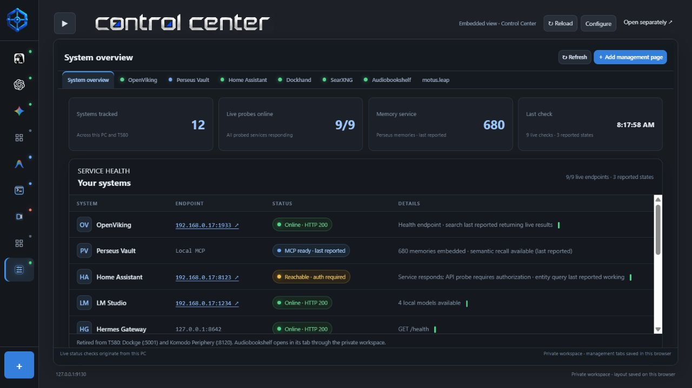

# arnés Control Center

Published by **Atomic 22 Industries**.

A local browser workspace for agent dashboards, service health and provider information.

[Website](https://dave-patrick.github.io/arnes-control-center/) · [Downloads](https://github.com/dave-patrick/arnes-control-center/releases) · [Help](documentation/HELP.md)



## Run

Requires Node.js 22 or later. No npm dependencies are required.

```powershell
npm start
```

Open http://127.0.0.1:9130/ . Optional commands: `npm run bridge` (Codex on 9131) and `npm run hermes-proxy` (proxy on 9132). The optional Codex bridge currently requires Windows with the authenticated npm-global Codex CLI at %APPDATA%/npm/node_modules/@openai/codex/bin/codex.js. Other installation layouts are not automatically discovered. These commands require their separately installed upstream tools. The package does not install Codex, Hermes or your other services.

## Features

- Persistent browser tabs for harnesses and dashboards, configuration, reload, collapsed navigation and external opening.
- Control Center overview with service probes and separate reported state.
- Searchable provider/model catalog, configured-provider navigation and external account consoles.
- Supported provider balances/usage using your own local credentials.
- Gemini configuration/model discovery and optional Codex bridge.

## Clean publication copy

This repository preserves the working app's source and approved branding. Machine-specific IP addresses have been replaced with localhost examples; private Tailnet names use `hub.example.invalid`. Configure the addresses and matching host/origin allowlists for your installation. Credentials, logs, browser state and startup tasks are excluded. The existing installed workspace was not modified.

Screenshots are historical captures of the configured app. They do not establish the downloadable package's live service state. This initial source package has syntax/static checks; integration with every upstream service requires local verification.

## Repository guide

- `app/`: Node servers and browser application.
- `site/`: GitHub Pages landing page, help and screenshots.
- [Setup, options and troubleshooting](documentation/HELP.md).
- [Architecture and privacy](documentation/ARCHITECTURE.md).
- [Publication process](documentation/PUBLISHING.md).
- `scripts/check.mjs`: syntax and static-asset checks without starting services.

Run `npm run check` and `npm run check:site` before publishing. MIT licence applies to this project's code; third-party service names and logos identify their respective products. The provider catalog is derived from models.dev; see [third-party notices](THIRD-PARTY-NOTICES.md).

